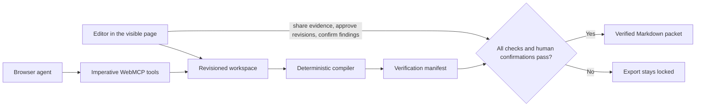

# Evidence Workspace

Status: active local release candidate. It is not deployed or submitted. A complete native WebMCP lifecycle is verified locally in Chrome 150 with WebMCP testing enabled; ChatGPT execution has not been captured.

AI-assisted reports often reach an editorial operations lead with confident numbers and weak release evidence. Evidence Workspace turns that last review into a visible, fail-closed workflow: a browser agent can discover evidence the editor shared, run deterministic checks, and stage corrected wording, but every claim still needs a human confirmation before export.

The included walkthrough starts with a report claiming 40% growth. The linked source says weekly reviews rose from 50 to 60, so the compiler derives 20%, blocks release, and shows the failed arithmetic beside the wording. The agent stages a correction; the editor approves it. A second supported claim remains blocked until its source is shared with the site tools and the compiled finding is confirmed.

All bundled report material is authored fixture data and is labeled in the interface. The compiler checks internal consistency between typed assertions, exact source excerpts, units, scope, and arithmetic. It does not determine objective truth.

## Architecture



The React interface and WebMCP handlers call the same domain functions. Agent writes require the current workspace revision. Evidence not shared with site tools is denied by those tools, calls canceled before the synchronous commit boundary do not commit, stale proposals cannot be approved, missing or conflicting sources fail closed, and the export tool is registered only while the release invariant passes. After a successful commit, export-tool registration reconciles independently and cancellation cannot roll back the recorded workspace revision. Each compiled claim has a Verification Trace that shows the source result, claim value, relation, human decision, and ordered checks without inventing release state. Valid workspaces persist in browser local storage; malformed stored data is quarantined and replaced with the labeled safe example.

## Site tools

- `review_get_summary`: compact release state without source passages
- `review_list_claims`: current wording and review states
- `review_list_shared_evidence`: minimal metadata and fact summaries for evidence the human permits site tools to use; never exact passages
- `review_get_claim_context`: one claim and only its linked evidence shared with site tools
- `review_run_checks`: read-only deterministic compiler output
- `review_link_evidence`: revision-guarded evidence link
- `review_unlink_evidence`: revision-guarded evidence unlink that invalidates prior decisions
- `review_flag_claim`: records a review state; `supported` is rejected unless checks pass
- `review_propose_revision`: stages wording and an optional typed assertion for human review
- `review_get_release_check`: exact blockers and next human action
- `review_export_packet`: dynamically available only after every release invariant passes

No WebMCP tool can approve a proposal, confirm a finding, download a file, publish a report, or change evidence-sharing permissions.

## Run locally

Requirements: Node.js 20+ and Corepack.

```bash
corepack pnpm install
corepack pnpm dev
```

Open the printed local URL. In development only, the “Run next fixture agent step” control drives the same domain path for local walkthroughs, but it is explicitly not proof of a real WebMCP client call. Production builds omit this fixture driver.

Use **New review** to create a browser-local report, claim, and evidence record without editing JSON. **Add claim** and **Add evidence** extend that review. The builder accepts percentage, before/after, and scalar assertions; requires exact excerpts and source windows to appear in the supplied passage; rejects ambiguous numbers and zero percentage baselines; and excludes evidence from WebMCP tool responses unless the human explicitly shares it. Evidence passages remain visible in the human-facing page; this is a site-tool permission boundary, not DOM confidentiality.

Use **Export workspace JSON** to download the current typed workspace as a template or backup. **Import workspace JSON** loads a typed workspace locally. Imports are schema-validated, capped at 1 MB, persisted only in the browser, and rejected if claim state or assertion structure is malformed. Review every imported evidence-sharing flag before using site tools.

## Test WebMCP in Chrome

Use Chrome 149 or newer. Open `chrome://flags/#enable-webmcp-testing`, enable WebMCP testing, and restart Chrome completely. Then open the application in the restarted browser. The header should report **Site tools registered**; if it reports **WebMCP unavailable**, the browser has not exposed `document.modelContext` to the page.

The production build is a static site:

```bash
corepack pnpm build
corepack pnpm preview --host 127.0.0.1 --port 4173
```

The fixture driver is intentionally absent from this production preview. Real WebMCP clients should discover ten tools while release is locked and an eleventh, `review_export_packet`, only after every claim passes and receives current human confirmation.

## Verify

```bash
corepack pnpm check
```

The command runs TypeScript checks, Vitest contracts, and a production build. The suite covers percentage, before/after, scalar, and grouped-number checks; visible-wording and metric binding; exact-excerpt binding; linked-source relevance; fact-shape, source, unit, scope, and conflict checks; private evidence; decision invalidation; pending and stale proposals; canceled tool calls and the commit boundary; race-safe dynamic export registration; review creation; storage-denial recovery, import normalization, safe revisions, and referential integrity; Verification Trace rendering; cleanup; and the release invariant.

Local headless-Chrome checks cover review creation, the contradiction-to-approval flow, persisted release state, reduced motion, storage-denial recovery, modal keyboard containment, and zero horizontal overflow from 1440 down to 320 CSS pixels. A separate Chrome 150 probe discovered all ten locked-state tools and executed the complete native WebMCP path: shared-evidence discovery, link, unlink and relink, deterministic checks, contradiction flagging, staged correction, privacy and stale-write denials, second-claim verification, release checks, dynamic export discovery, and packet export. The three human-only controls were exercised separately through the page DOM by the automated probe and are recorded as such; this is not proof a person was present. ChatGPT execution, public deployment, public repository, demo video, and Devpost submission remain separate external gates.

## Current boundary

- Local fixture and automated checks: verified
- Human browser flow in headless Chrome: verified locally
- Chrome 150 WebMCP registration, ten-tool locked discovery, full semantic read/link/unlink/check/stage/release/export lifecycle, stale denial, and private-evidence denial on the local origin: verified
- ChatGPT WebMCP execution: unverified and optional for eligibility because Chrome is a supported testing route
- Validated browser-local persistence: verified locally
- Human-created reviews plus validated typed workspace JSON import/export: verified locally
- Raw Markdown/PDF extraction into typed assertions and exact excerpts: not implemented
- Deployment, public repository, video, and submission: not completed

## License

[MIT](./LICENSE)
