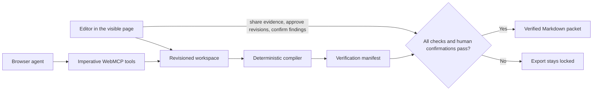

# Evidence Workspace

Status: active local prototype. It is not deployed or submitted. Native discovery and bounded tool execution are verified locally in Chrome 150 with WebMCP testing enabled; ChatGPT execution has not been captured.

AI-assisted reports often reach an editor with confident numbers and weak release evidence. Evidence Workspace turns that last review into a visible, fail-closed workflow: a browser agent can inspect evidence the editor shared, run deterministic checks, and stage corrected wording, but every claim still needs a human confirmation before export.

The included walkthrough starts with a report claiming 40% growth. The linked source says weekly reviews rose from 50 to 60, so the compiler derives 20%, blocks release, and shows the failed arithmetic beside the wording. The agent stages a correction; the editor approves it. A second supported claim remains blocked until its private source is shared and the compiled finding is confirmed.

All bundled report material is authored fixture data and is labeled in the interface. The compiler checks internal consistency between typed assertions, exact source excerpts, units, scope, and arithmetic. It does not determine objective truth.

## Architecture



The React interface and WebMCP handlers call the same domain functions. Agent writes require the current workspace revision. Private evidence is denied, canceled calls do not commit, stale proposals cannot be approved, missing or conflicting sources fail closed, and the export tool is registered only while the release invariant passes. Valid workspaces persist in browser local storage; malformed stored data is quarantined and replaced with the labeled safe example.

## Site tools

- `review_get_summary`: compact release state without source passages
- `review_list_claims`: current wording and review states
- `review_list_shared_evidence`: minimal metadata and fact summaries for evidence the human permits; never private passages
- `review_get_claim_context`: one claim and only its linked, human-shared evidence
- `review_run_checks`: read-only deterministic compiler output
- `review_link_evidence`: revision-guarded evidence link
- `review_flag_claim`: records a review state; `supported` is rejected unless checks pass
- `review_propose_revision`: stages wording and an optional typed assertion for human review
- `review_get_release_check`: exact blockers and next human action
- `review_export_packet`: dynamically available only after every release invariant passes

No WebMCP tool can approve a proposal, confirm a finding, download a file, publish a report, or change evidence-sharing permissions.

## Run locally

Requirements: Node.js 20+ and Corepack.

```bash
corepack pnpm install
corepack pnpm dev
```

Open the printed local URL. The “Run next fixture agent step” control drives the same domain path for local walkthroughs, but it is explicitly not proof of a real WebMCP client call.

Use **Export workspace JSON** to download the current typed workspace as a template. After replacing its claims, exact excerpts, and structured facts, use **Import workspace JSON** to load it locally. Imports are schema-validated, capped at 1 MB, persisted only in the browser, and rejected if claim state or assertion structure is malformed. Review every imported evidence-sharing flag before using site tools.

## Verify

```bash
corepack pnpm check
```

The command runs TypeScript checks, Vitest contracts, and a production build. Current automated coverage includes compiler arithmetic, exact-excerpt binding, missing and conflicting sources, private evidence, human confirmation, stale proposals, canceled tool calls, dynamic export registration, cleanup, and the release invariant.

Local headless-Chrome checks cover the contradiction-to-approval flow and 320px horizontal overflow. A separate Chrome 150 WebMCP probe discovered the locked-state tools, executed a read, executed a visible evidence-link write from revision 1 to 2, and confirmed stale-revision and private-evidence denials without mutation. The new shared-evidence discovery tool is contract-tested but still needs to be added to the native end-to-end receipt. ChatGPT execution, public deployment, public repository, demo video, and Devpost submission remain separate external gates.

## Current boundary

- Local fixture and automated checks: verified
- Human browser flow in headless Chrome: verified locally
- Chrome 150 WebMCP registration, discovery, read, visible write, stale denial, and private-evidence denial on the local origin: verified
- ChatGPT WebMCP execution: unverified and optional for eligibility because Chrome is a supported testing route
- Validated browser-local persistence: verified locally
- Validated user-supplied workspace JSON import/export: verified locally
- Raw Markdown/PDF extraction into typed assertions and exact excerpts: not implemented
- Deployment, public repository, video, and submission: not completed

## License

[MIT](./LICENSE)
