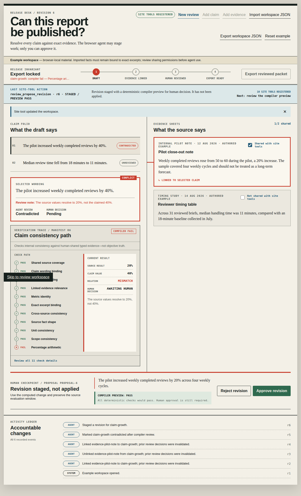
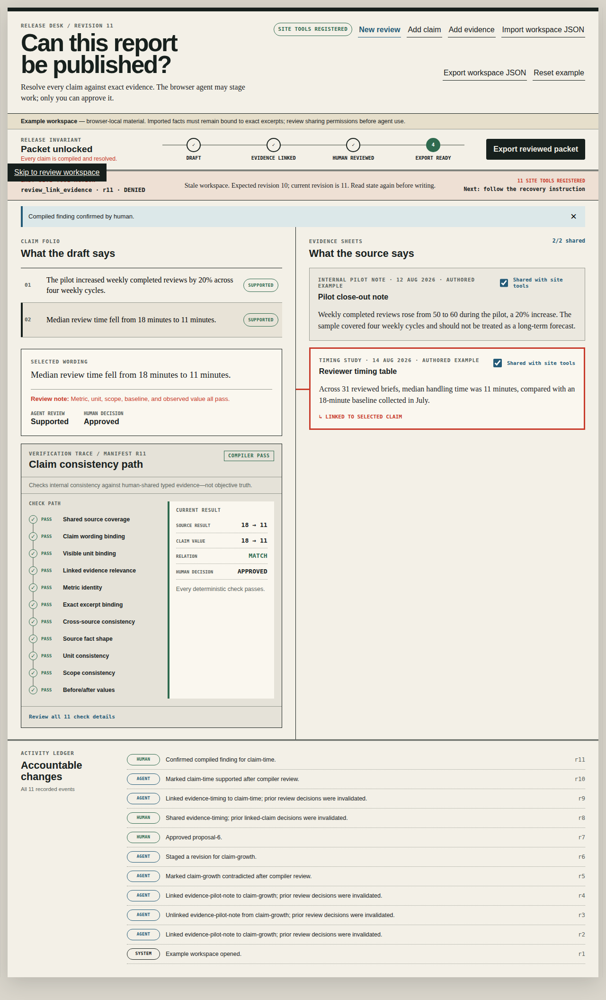
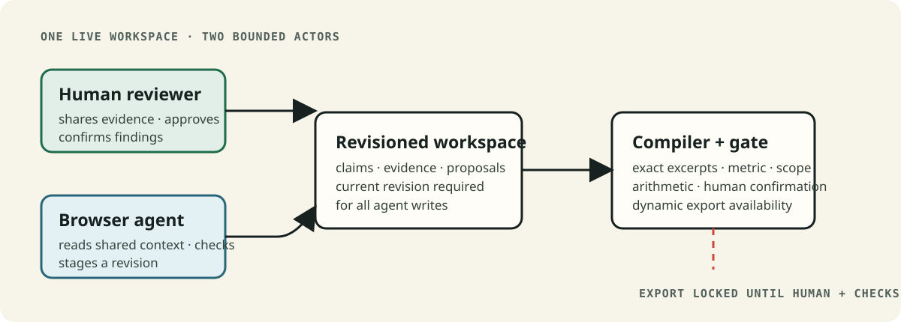

# Evidence Workspace

Evidence Workspace helps an editorial or research-operations lead review AI-assisted claims before publication. A browser agent can inspect the evidence the person chose to share, run consistency checks, and stage a correction. It cannot approve a claim or release the report.

**Live application:** [anand-0038.github.io/evidence-workspace](https://anand-0038.github.io/evidence-workspace/)

**Current status:** the public application and its native Chrome WebMCP path are verified. The demo video is complete locally but is not yet published, and the challenge submission is not yet final.

## The problem

A report can contain a confident number that does not match its source: “weekly reviews increased by 40%” when the cited change from 50 to 60 is 20%. Finding that mismatch is only half the job. The person responsible for publication also needs to see the source, decide whether a proposed correction is appropriate, and keep an accountable record of that decision.

Evidence Workspace keeps that review in one place.

## How it works

1. Create a browser-local review and add claims with exact source excerpts.
2. Share only the evidence a browser agent may use.
3. The agent reads typed claim context, runs deterministic checks, and can stage a revision against the current workspace revision.
4. The reviewer accepts or rejects that revision and confirms each passing claim.
5. Export becomes available only after every claim passes and has a current human confirmation.

Human controls and WebMCP tools operate on the same revisioned workspace, with different authority. The agent may propose. The human may approve and release.

## What WebMCP adds

Without WebMCP, an agent would need an ad hoc integration or brittle screen interaction to understand a live review. This application exposes narrow, typed, contextual actions directly from the browser:

- evidence sharing determines what an agent can read;
- writes require the current workspace revision, so stale requests are denied;
- the agent can stage a correction but cannot approve it, confirm a finding, change sharing permissions, download a packet, or publish externally;
- the export tool is registered only when the release conditions pass.

## Local captures

The captures below were made in Chrome 150 on the included **authored fixture** and local origin. They demonstrate the local browser integration only; they are not proof of deployment, ChatGPT execution, or a person being present.

<a href="public/screenshots/local-webmcp-proposal.png"></a>

*A native WebMCP tool call staged this correction with a passing compiler preview; the reviewer still decides whether to apply and confirm it.*

<a href="public/screenshots/local-webmcp-execution.png"></a>

*After the ready-state export succeeds, making linked evidence private invalidates the finding and removes `review_export_packet`; the automated human-control step is not evidence that a person was present.*

## Architecture



The React interface and WebMCP handlers call the same domain functions. The compiler checks typed assertions against exact excerpts, metric identity, visible units, scope, arithmetic, source shape, relevance, and conflicts. It checks consistency inside the supplied evidence; it does **not** determine objective truth.

## Privacy and boundaries

- Reviews, imported JSON, and exported packets remain in the browser. There is no account, server, database, or automatic upload.
- Evidence marked private from the browser agent is excluded from WebMCP responses. It remains visible in the human page, so this is a tool-permission boundary—not DOM confidentiality.
- Bundled reports are authored fixtures. They are examples, not customer data or live reporting.
- Import accepts a validated, typed workspace JSON file up to 1 MB. It does not parse arbitrary Markdown or PDFs.

## Run locally

Requirements: Node.js 20+ and Corepack.

No API key, backend, or environment variable is required. The intentionally empty `.env.example` documents that boundary; do not add credentials for the browser-local workflow.

```bash
corepack pnpm install
corepack pnpm dev
```

Open the printed local URL. Use **New review** to create a browser-local report, claim, and evidence record. **Add claim** and **Add evidence** extend the review. The builder supports percentage, before/after, and scalar assertions and rejects malformed excerpts, ambiguous numbers, and zero percentage baselines.

`Export workspace JSON` creates a local backup or template. `Import workspace JSON` validates and loads a local typed workspace. Review evidence-sharing flags before enabling browser-agent tools.

### Test WebMCP in Chrome

Use Chrome 149 or newer. Open `chrome://flags/#enable-webmcp-testing`, enable WebMCP testing, and restart Chrome completely. Then reopen the application. The header should report **WebMCP ready**. If it reports **Manual review mode**, the browser has not exposed `document.modelContext` to the page; the complete human review path remains available.

For a production-style local preview:

```bash
corepack pnpm build
corepack pnpm preview --host 127.0.0.1 --port 4173
```

A real client discovers ten tools while export is locked and an eleventh, `review_export_packet`, only after every release condition passes. If a release condition becomes invalid, that capability is removed; resolving and reconfirming the affected claim registers it again.

## Verify

```bash
corepack pnpm check
```

This runs TypeScript checks, 73 Vitest contracts, and a production build. The suite covers visible metric/value/scope binding, exact excerpts, scalar/range source presentation, zero baselines, tool-permission denials, stale and cancelled writes, proposal and decision invalidation, import validation and provenance, persistence recovery, race-safe dynamic export registration, and the release invariant.

The verified public-origin Chrome 150 path includes 19 native calls covering discovery, evidence linking, deterministic checks, staged correction, duplicate/stale/private denials, dynamic export, invalidation, recovery, re-registration, and a second successful packet export. The observed tool counts were `10 → 11 → 10 → 11 → 10`, with no browser console errors. Human-only controls were exercised separately through the page DOM by an automated probe; that verifies the guarded UI path, not a person-present decision.

Seven natural-language Codex model tasks also ran through a controlled bridge to the native local WebMCP registry without operator argument repair. They covered read-only publishability triage, correction staging with a human stop, private-evidence handling, stale-revision recovery, wrong-link recovery, human-gated release, and export invalidation. Page-only checkpoint controls were exercised by the evaluation controller and recorded separately from model calls. This is local model-in-the-loop evidence, not person-present, deployed-origin, or ChatGPT execution proof.

## Tool reference

<details>
<summary>Available WebMCP tools</summary>

- `review_get_summary` — compact release state without source passages
- `review_list_claims` — current wording and review states
- `review_list_shared_evidence` — permitted evidence metadata and fact summaries
- `review_get_claim_context` — a claim and its permitted linked evidence
- `review_run_checks` — read-only deterministic compiler output
- `review_link_evidence` and `review_unlink_evidence` — revision-guarded evidence changes
- `review_flag_claim` — records a review state; `supported` requires passing checks
- `review_propose_revision` — stages wording and an optional typed assertion for human review
- `review_get_release_check` — blockers and next human action
- `review_export_packet` — dynamically available only when the release conditions pass

</details>

## Limits and next work

- The demo video is complete but has not yet been published to a public video URL.
- The Devpost challenge submission is not final until that public video URL is attached.
- ChatGPT execution has not been captured.
- The current workflow starts from typed claims and evidence; arbitrary-document extraction is not implemented.
- This is a consistency and release-control tool, not a service that proves a source is objectively true.

## License

[MIT](./LICENSE)
